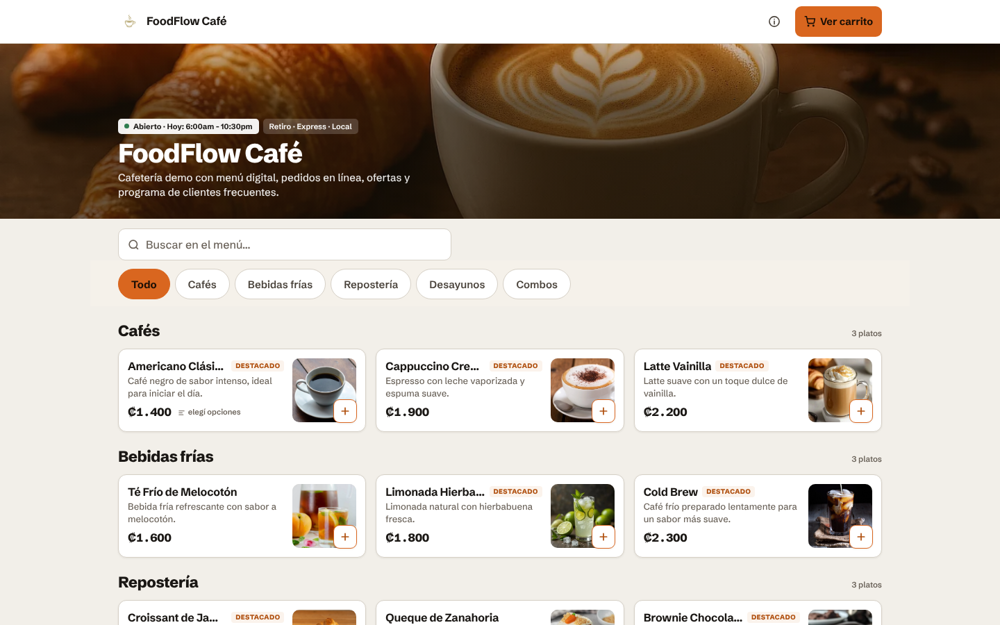
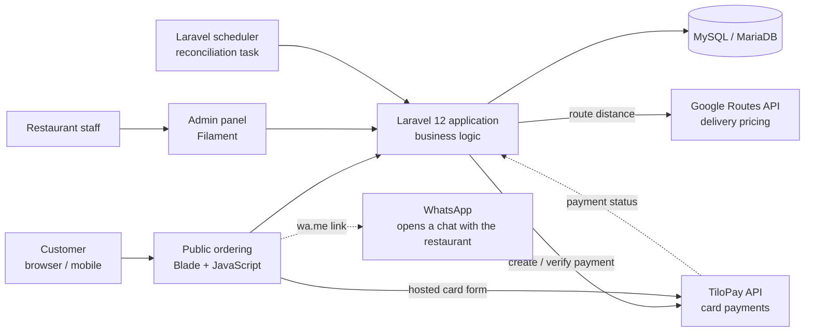
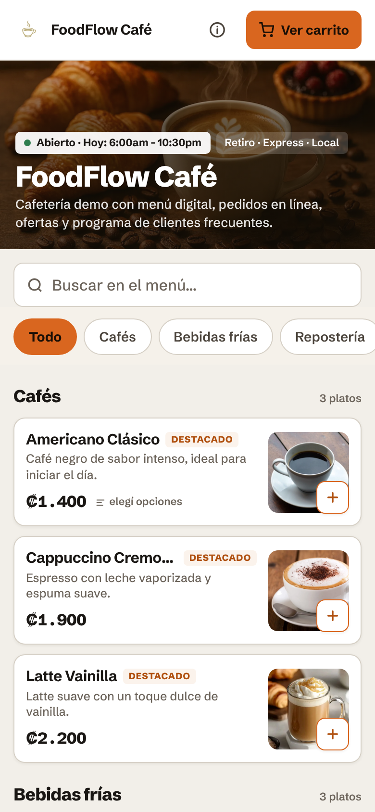
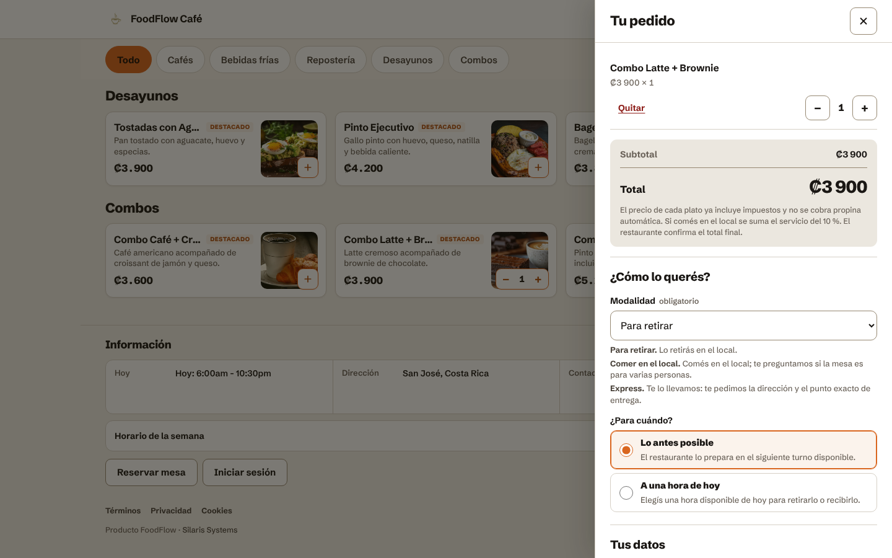
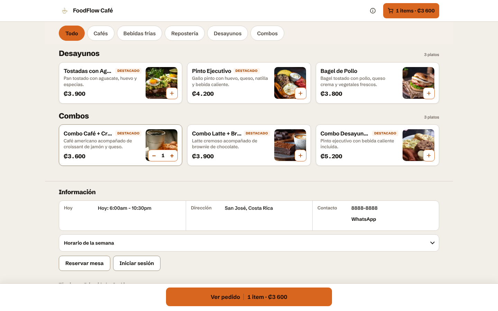
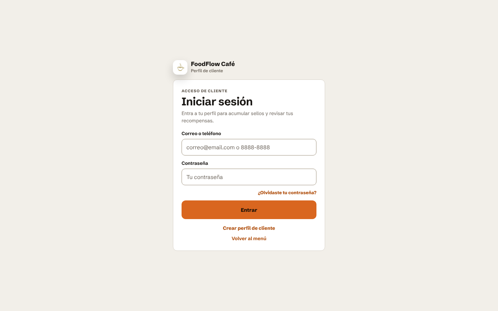

# FoodFlow

**Online ordering and restaurant management platform built with Laravel, Filament and Livewire.**
In production for a commercial client: [La Perrera Street Food](https://laperreracr.com) (Costa Rica).

> This is a public case study. The application source code is private and is not included here.

🔗 **Live client system:** [laperreracr.com](https://laperreracr.com) · **Public demo:** [foodflow.silarissystems.com](https://foodflow.silarissystems.com)

---

## The problem

Many small restaurants in Costa Rica take orders by WhatsApp. Order details get lost, prices are typed by hand and there is no record of payments or customers. FoodFlow gives them a single ordering flow:

1. The customer browses the digital menu, picks options and builds a cart.
2. They choose pickup, dine-in or delivery. Delivery is priced by distance.
3. They pay by card (TiloPay), SINPE Móvil (manual confirmation) or cash.
4. The restaurant manages orders, menu, availability and customers from an admin panel.

## What is in production

| Area | Features |
|---|---|
| Public ordering | Digital menu with search and categories, product options, persistent cart, pickup / dine-in / delivery, scheduled or ASAP orders |
| Payments | **TiloPay card payments** with hosted payment form, payment status handling, recovery flows and reconciliation logic (scheduled task) · SINPE Móvil with manual verification · cash |
| Delivery pricing | **Google Routes API** for distance-based delivery fees |
| Customer accounts & loyalty | Customer registration and login with privacy consent, password recovery, **loyalty stamps on orders**, rewards and order history |
| Admin panel (Filament) | Products, categories, options and availability; order status management; customers; activity log |
| Access control | Roles for super admin, owner and staff; data isolated per restaurant |
| Operations | Artisan commands for setup, updates, backups, restores and health checks |

## In development (not in production)

These are kept in separate branches and are **not** part of the deployed system:

- **Advanced loyalty:** extended loyalty features, including **Google Wallet loyalty passes** as a proof of concept. The production system uses the in-app stamps and rewards described above.
- **Uber Direct delivery:** integration built against the Uber Direct **sandbox**.

## Architecture

**Stack:** PHP 8.3 · Laravel 12 · Filament 3 · Livewire · Blade · JavaScript · MySQL / MariaDB · Hostinger (Linux, SSH)

## Technical highlights

**Data model**
- Relational schema built and evolved through Laravel migrations, with foreign keys for referential integrity and composite indexes for frequent queries.
- Money stored as `decimal(10,2)`; product prices are **snapshotted** on each order so historical totals never change when the menu does.
- Public order requests carry a request key protected by a composite unique constraint, supporting **idempotent order creation**: if the same request is submitted again, the database rejects it instead of creating a second order from it.

**Payments (TiloPay)**
- Card details are entered in TiloPay's hosted payment form, not in FoodFlow's own forms.
- Explicit payment states with recovery flows for interrupted payments.
- Reconciliation logic checks pending payments against TiloPay and is registered as a scheduled Laravel task. Running it on a schedule depends on the server's cron configuration.

**Delivery pricing (Google Routes)**
- The delivery fee is calculated from the route distance between the restaurant and the customer's location.

**Operations**
- WhatsApp is used through standard `wa.me` links that open a chat with the restaurant; there is no WhatsApp Business API integration.
- Deployed on Hostinger over SSH: Git, Composer, database migrations, database, domain and SSL setup.
- Artisan tooling for environment setup, updates, backups, restores and health checks.

**Testing**
- The project includes automated tests written with PHPUnit (backend) and the Node.js test runner (frontend scripts). They exercise checkout, payment workflows and per-restaurant data isolation, using mocked responses for external APIs.

## How it was built

FoodFlow is a product of Silaris Systems, my own software venture. I defined the requirements and priorities, researched the integrations, directed the AI-assisted implementation and manually tested and refined the implemented workflows in the application.

## Screenshots

All screenshots come from the public demo, which uses sample data. They do not include client data.

| Public menu (mobile) | Order and checkout |
|---|---|
|  |  |

| Cart controls | Customer accounts |
|---|---|
|  |  |

## Author

**Jose Armando Siles Arroyo** · Founder & Software Developer, Silaris Systems
[LinkedIn](https://www.linkedin.com/in/jose-armando-siles-arroyo/) · [GitHub](https://github.com/xJoseAS1201)
